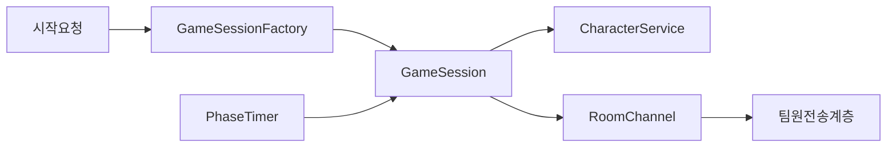

# 12주차 개인 담당 설계 — 게임 세션·직업 배정·밤 단계

작성일: 2026-11-09. 수업 주차에 대응시킨 사전 제작 체크포인트이며 실제 주차별 작업 날짜를 소급해서 표시한 기록이 아니다.

## 책임과 도메인

GameSession은 한 판의 단계·생존 상태를 소유한다. PhaseTable은 단계별 허용 명령과 시간을 설명하며 PhaseTimer는 만료를 통지한다. 역할은 주입받아 배정하고 CharacterService에 능력 유효성 및 밤 결과 계산을 위임한다.

역할 분담은 제공된 아키텍처 v2 및 도메인 모델링 문서를 기준으로 삼았다. 민준 담당은 게임 진행/판정과 클라이언트 흐름·씬·투표·표시 UI다. Socket 전송, 방 관리 정책, 채팅, 직업 능력 구현은 팀원 담당으로 남긴다. 기존 원본의 공통/오프라인 뼈대는 유지한다.

## 흐름

## 결합 계약

서버에서는 RoomChannel(송신), GameEventHandler(게임 입력), CharacterService/RoleAbility(직업 능력)를 경계로 삼는다. 클라이언트에서는 기존 Connection과 제안한 AbilityView/ChatView를 주입한다. 공동 계약의 선언은 연결을 위한 제안이며 팀원 구현과 이름·생성자·콜백 정책을 맞춰야 한다.

추가 프로토콜 제안은 ROOM_STATE(S→C, 방번호/이름/공개여부/방장/준비목록), LEAVE_ROOM(C→S, 0필드), ROOM_LEFT(S→C, 1필드)다. 준비목록은 `이름:true,...` 형식이며 현재 구분자 제한을 공유한다. 공동 합의 전에는 기존 서버와 그대로 호환된다고 보장하지 않는다.

## 완료와 한계

아래 구현 문서의 검증 범위까지만 완료로 본다. 테스트용 모형 부품의 성공은 팀원 최종 코드의 실제 네트워크 결합 성공을 뜻하지 않는다.
